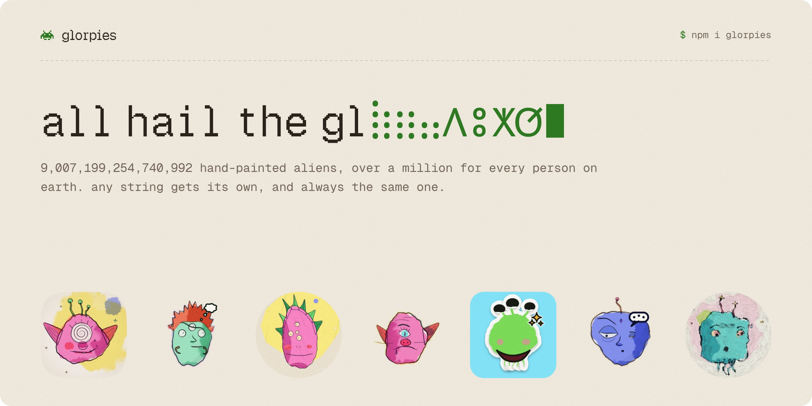
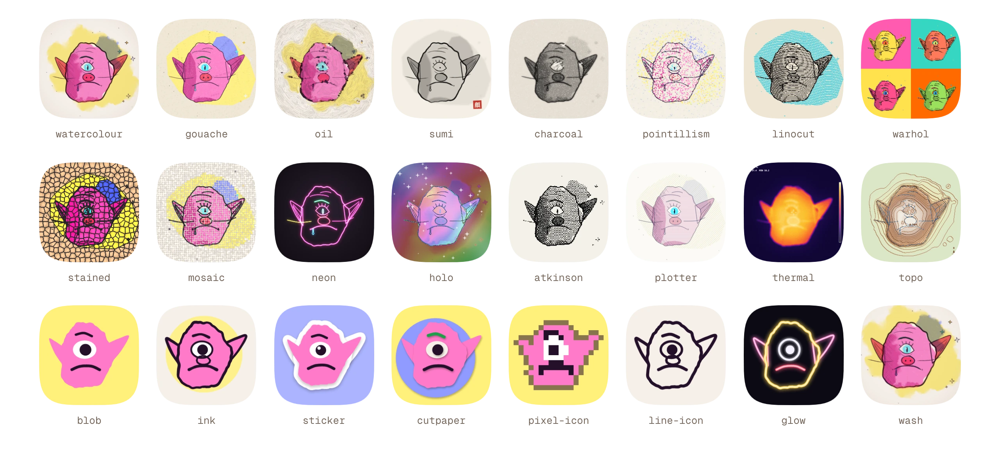
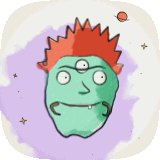
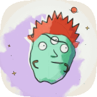
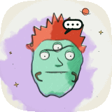
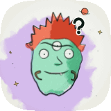
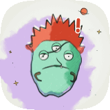
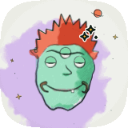

<picture>
  <source media="(prefers-color-scheme: dark)" srcset=".github/assets/banner-dark.webp">
  
</picture>

<p align="center">
  <a href="https://www.npmjs.com/package/glorpies"></a>
  
  
  <a href="LICENSE"></a>
</p>

<p align="center">
  <a href="https://glorpies.vercel.app"><b>./site</b></a> &nbsp;·&nbsp;
  <a href="https://glorpies.vercel.app/gallery">./gallery</a> &nbsp;·&nbsp;
  <a href="https://glorpies.vercel.app/how">./how</a> &nbsp;·&nbsp;
  <a href="https://glorpies.vercel.app/docs">./docs</a>
</p>

Ugly little alien avatars, hand-painted in watercolour and dip pen from any string. Antennae, extra eyes, horns, halos, too many teeth.

There are **9,007,199,254,740,992** of them, over a million for every person on earth. A username, an email or a bot id gets its own, and always the same one: on every device, on every server, with nothing stored and no API to call. And they're alive: they breathe, blink and glance at you.

## ⵣ install

```bash
npm i glorpies
```

## ⵅ use

**React**

```tsx
import { Glorpie } from 'glorpies/react';

<Glorpie name="ada@lovelace.dev" size={48} />
```

**Anywhere else: one tag** (plain HTML, Vue, Svelte, Astro…)

```html
<script type="module" src="https://unpkg.com/glorpies"></script>

<glorpie-face name="ada@lovelace.dev" size="48"></glorpie-face>
```

**As images, from your own server** (for emails, OG images, anything that needs a URL)

```ts
// app/api/face/route.ts
import { faceRoute } from 'glorpies/server';
export const { GET } = faceRoute();

// GET /api/face?name=ada@lovelace.dev&look=ink&size=128&format=png
```

**From a terminal**

```bash
npx -p glorpies -p @napi-rs/canvas glorpies ada@lovelace.dev --size 256 -o ada.png
```

## ⵔ examples

**A user avatar that's never blank.** Their photo if they have one; their face while it loads, if it fails, or if there isn't one.

```tsx
import { Avatar, AvatarFallback, AvatarImage } from 'glorpies/react';

<Avatar size={40}>
  <AvatarImage src={user.photoUrl} alt={user.name} />
  <AvatarFallback name={user.email} />
</Avatar>
```

**Agents that show their status.** The face changes with the state, so a sidebar reads at a glance.

```tsx
{agents.map((agent) => (
  <Glorpie key={agent.id} name={agent.id} state={agent.status} size={32} label={agent.name} />
))}
```

**Faces in emails and link previews**, where there's no JavaScript: an image from your own route.

```html

```

**A page themed to its face.** `faceColors` is the palette a face is painted in.

```ts
import { faceColors } from 'glorpies';

const { bg, accent } = faceColors(user.email);
header.style.background = bg;
```

**Vue, Svelte, Angular or plain HTML.** Import the element once, then use the tag anywhere.

```ts
import 'glorpies/element';
// <glorpie-face name="ada@lovelace.dev" size="40" look="sticker"></glorpie-face>
```

**Avatars for a whole team, from a terminal.**

```bash
for name in ada grace linus; do npx glorpies "$name" --look sticker --size 256; done
```

Everything else (every prop, look, state, query parameter and function) is in **[the docs](https://glorpies.vercel.app/docs)**.

## ⵙ looks

29 of them: 21 paintings for faces shown large, and 8 avatar looks that still read at 16px. Every look works without its background too (`background={false}`): only the face, on nothing.

<picture>
  <source media="(prefers-color-scheme: dark)" srcset=".github/assets/looks-dark.webp">
  
</picture>

## ⵀ moods

Made for agents too: a face you can pick out of a crowded sidebar, with a status you read from the face itself. Each state changes the expression, how the head moves, and adds a mark that reads at 32px.

| `idle` | `thinking` | `working` | `waiting` | `blocked` | `done` |
| :---: | :---: | :---: | :---: | :---: | :---: |
|  |  |  |  |  |  |

```tsx
<Glorpie name="agent-47" state="thinking" />
```

## ⵚ how it's drawn

A name hashes to a 53-bit seed, and the seed drives a random stream (sfc32) and a noise field. From them comes the alien, as a list of drawing operations: watercolour glazes, hatching, pen lines and solid fills, plus the parts that move (pupils, lids). That list is painted once per "line boil" frame, so the pen wobbles like hand-drawn animation, and the eyes are drawn live on top. Only the blinks and glances are left to chance; the face depends on the name alone, so it comes out the same at any size, as a PNG, as SVG paths or as a looping GIF.

[Watch it paint one](https://glorpies.vercel.app/how), step by step, or read [the faq](https://glorpies.vercel.app/docs/faq) on why the same name gives the same face everywhere.

## this repo

`packages/glorpies` is the library, with zero runtime dependencies. `src/` is the site, a Next.js app that also runs the library's image route at `/api/face` as a demo.

```bash
pnpm install
pnpm dev --port 3417     # http://localhost:3417
pnpm typecheck && pnpm test
```

- `packages/glorpies/src/face/build.ts` turns a seed into an alien. `src/engine.ts` is the seeded randomness and noise.
- `packages/glorpies/src/face/render.ts` paints and animates a face; `src/stage.ts` runs one animation loop for every face on a page. `src/styles.ts` and `src/small.ts` repaint faces in the other looks.
- `scripts/` holds headless Chrome checks, and `readme-art.mjs`, which draws the pictures in this README and the site's link preview.

See [CONTRIBUTING.md](CONTRIBUTING.md) before a pull request. There's one rule: an existing face must never change.

## credits

Made by **[sunrakerr](https://github.com/sunrakerr)**.

The API takes its lead from [facehash](https://facehash.dev). GIFs are encoded with [gifenc](https://github.com/mattdesl/gifenc).

[MIT](LICENSE)
