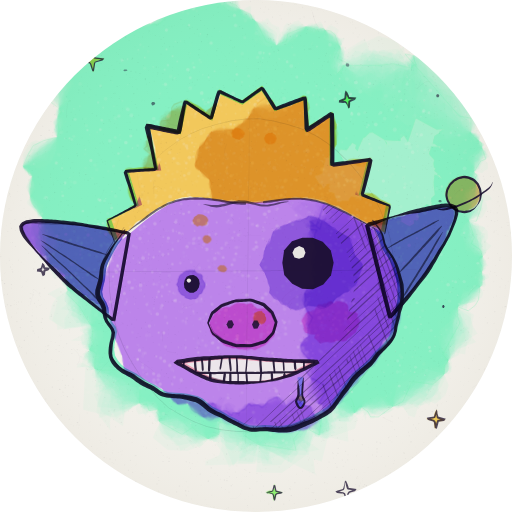

<p align="center">
  <a href="https://glorpies.vercel.app"></a>
</p>

<h1 align="center">glorpies</h1>

<p align="center"><b>Ugly little alien avatars from any string.</b></p>

<p align="center">
  
  
  <a href="LICENSE"></a>
</p>

<p align="center">
  <a href="https://glorpies.vercel.app"><b>./site</b></a> &nbsp;·&nbsp;
  <a href="https://glorpies.vercel.app/gallery">./gallery</a> &nbsp;·&nbsp;
  <a href="https://glorpies.vercel.app/how">./how</a> &nbsp;·&nbsp;
  <a href="https://glorpies.vercel.app/docs">./docs</a>
</p>

Hand-painted in watercolour and dip pen. Antennae, extra eyes, horns, halos, too many teeth. And they're alive: they breathe, blink and glance at you.

**9,007,199,254,740,992** faces, over a million for every person on earth. A username, email or bot id always gets the same one, on every device and server. No API calls, no image downloads, nothing to store.

Use them for **user avatars** and photo fallbacks, **AI agents and bots** (with moods that show what they're doing), chat and comments, multiplayer cursors, guest and anonymous users, and placeholder people in demos and seed data.

## ⵣ quick start

```bash
npm i glorpies
```

```tsx
import { Glorpie } from 'glorpies/react';

<Glorpie name="sunrakerrisfriednoodlz" size={48} />
```

By default, small avatars use the ink look; at 72px and above they use watercolour. To paint the Glorpie at the top of this page:

```tsx
<Glorpie name="sunrakerrisfriednoodlz" look="watercolour" size={192} />
```

## ⵅ frameworks

Every framework gets a `<Glorpie>` that takes the same options:

| framework | import | guide |
| --- | --- | --- |
| React, Next.js | `import { Glorpie } from 'glorpies/react'` | [React](https://glorpies.vercel.app/docs/react) |
| Vue 3, Nuxt | `import { Glorpie } from 'glorpies/vue'` | [Vue](https://glorpies.vercel.app/docs/vue) |
| Svelte 4 and 5, SvelteKit | `import { Glorpie } from 'glorpies/svelte'` | [Svelte](https://glorpies.vercel.app/docs/svelte) |
| Solid, SolidStart | `import { Glorpie } from 'glorpies/solid'` | [Solid](https://glorpies.vercel.app/docs/solid) |
| Preact | `import { Glorpie } from 'glorpies/preact'` | [Preact](https://glorpies.vercel.app/docs/preact) |
| Angular, Astro, Lit, plain HTML | `import 'glorpies/element'`, then `<glorpie-face>` | [Web component](https://glorpies.vercel.app/docs/html) |

Components render a coloured placeholder on the server, then paint on a canvas in the browser. Faces paint when they approach the screen and animate only while visible. Reduced-motion preferences are respected by default.

**No build step?** One script tag:

```html
<script type="module" src="https://unpkg.com/glorpies"></script>

<glorpie-face name="ada@lovelace.dev" size="48"></glorpie-face>
```

## ⵙ looks

29 of them: 21 paintings for faces shown large, and 8 avatar looks that still read at 16px. Every look works without its background too (`background={false}`): only the face, on nothing. Or on a colour of your own: `background="#ffe9a8"`.

<picture>
  <source media="(prefers-color-scheme: dark)" srcset=".github/assets/looks-dark.webp">
  
</picture>

[Explore all 29 looks](https://glorpies.vercel.app/docs/looks), or [pick a face in the gallery](https://glorpies.vercel.app/gallery).

## ⵀ moods

Made for agents too: a face you can pick out of a crowded sidebar, with a status you read from the face itself. Each state changes the expression, how the head moves, and adds a mark that reads at 32px.

| `idle` | `thinking` | `working` | `waiting` | `blocked` | `done` |
| :---: | :---: | :---: | :---: | :---: | :---: |
|  |  |  |  |  |  |

```tsx
<Glorpie name="agent-47" state="thinking" />
```

## ⵎ options

The same props on every `<Glorpie>`, or attributes on `<glorpie-face>`:

| prop | default | what it does |
| --- | --- | --- |
| `name` | required | A string or numeric seed. The same name always gets the same face. |
| `size` | `48` | Pixels, or a CSS length such as `"3rem"`. |
| `look` | `"auto"` | Any of the 29 looks. `auto` uses ink below 72px and watercolour at 72px and above. |
| `shape` | `"circle"` | `circle`, `squircle`, `rounded` or `square`. |
| `background` | `true` | `false` removes the backdrop and crop, leaving a transparent background. A colour (`"#ffe9a8"`) puts the face on it instead, inside the crop. |
| `state` | `"idle"` | `idle`, `thinking`, `working`, `waiting`, `blocked` or `done`. |
| `alive` | on, unless reduced motion | Breathing, blinking and glancing. Set `false` for a still face. |
| `pokeable` | `false` | A tap makes the face wobble. |
| `label` | `"Avatar"` | Accessible name for the face. |

[All options and error handling](https://glorpies.vercel.app/docs/options).

## ⵔ examples

**A user avatar that's never blank.** Their photo if they have one; their face while it loads, if it fails, or if there isn't one.

```tsx
import { Avatar, AvatarFallback, AvatarImage } from 'glorpies/react';

<Avatar size={40}>
  <AvatarImage src={user.photoUrl} alt={user.name} />
  <AvatarFallback name={user.email} />
</Avatar>
```

**Agents that show their status.** The face changes with the state, so a sidebar reads at a glance.

```tsx
import { Glorpie } from 'glorpies/react';

{agents.map((agent) => (
  <Glorpie key={agent.id} name={agent.id} state={agent.status} size={32} label={agent.name} />
))}
```

**Faces in emails and link previews**, where there's no JavaScript: an image from your own route.

```html

```

**A page themed to its face.** `faceColors` is the palette a face is painted in.

```ts
import { faceColors } from 'glorpies';

const { bg, accent } = faceColors(user.email);
header.style.background = bg;
```

## ⵡ server images

For emails, Open Graph images, chat integrations and anywhere else that needs an image URL, serve faces from your own app. Image rendering and the CLI need the optional `@napi-rs/canvas` peer dependency. Node deployments support Node 22 and newer.

```bash
npm i glorpies @napi-rs/canvas
```

```ts
// app/api/face/route.ts (Next.js)
import { faceRoute } from 'glorpies/server';

export const { GET } = faceRoute();
```

Then use your route:

```text
/api/face?name=agent-47&look=ink&size=128&format=png
/api/face?name=agent-47&state=thinking&format=gif
```

PNG, WebP, JPEG, SVG and seamless GIF loops, cached for a year by default. `createFaceHandler()` works with fetch-based servers; `nodeFaceHandler()` works with Express and `node:http`.

[Server setup for every framework, query parameters and limits](https://glorpies.vercel.app/docs/server).

## ⵜ cli

Write a face straight to a file:

```bash
npx -p glorpies -p @napi-rs/canvas glorpies sunrakerrisfriednoodlz --look watercolour --size 512 --shape circle -o glorpie.png
```

Or a whole team, after installing `glorpies` and `@napi-rs/canvas` in your project:

```bash
for name in ada grace linus; do npx glorpies "$name" --look sticker --size 256; done
```

[CLI flags and formats](https://glorpies.vercel.app/docs/cli).

## ⵚ how it's drawn

A name hashes to a 53-bit seed, and the seed drives a random stream (sfc32) and a noise field. From them comes the alien, as a list of drawing operations: watercolour glazes, hatching, pen lines and solid fills, plus the parts that move (pupils, lids). That list is painted once per "line boil" frame, so the pen wobbles like hand-drawn animation, and the eyes are drawn live on top. Only the blinks and glances are left to chance; the face depends on the name alone, so it comes out the same at any size, as a PNG, as SVG paths or as a looping GIF.

[Watch it paint one](https://glorpies.vercel.app/how), step by step, or read [the faq](https://glorpies.vercel.app/docs/faq) on why the same name gives the same face everywhere.

## ⵛ this repo

`packages/glorpies` is the library, with zero runtime dependencies. `src/` is the site, a Next.js app. To work on the repo, use Node 26 and pnpm.

```bash
pnpm install
pnpm dev --port 3417     # http://localhost:3417
pnpm typecheck && pnpm test
```

- In `packages/glorpies/src/`, `face/build.ts` turns a seed into an alien and `engine.ts` supplies the seeded randomness and noise.
- In that same directory, `face/render.ts` paints and animates a face; `stage.ts` runs one animation loop for every face on a page. `styles.ts` and `small.ts` repaint faces in the other looks.
- `scripts/` holds headless Chrome checks, and `readme-art.mjs`, which draws the pictures in this README and the site's link preview.

glorpies is open source, and issues and pull requests are welcome. See [CONTRIBUTING.md](CONTRIBUTING.md) before a pull request. There's one rule: an existing face must never change. Report security issues privately, as [SECURITY.md](SECURITY.md) describes.

## ⵇ licence

Made by **[sunrakerr](https://github.com/sunrakerr)**.

[MIT](LICENSE)
