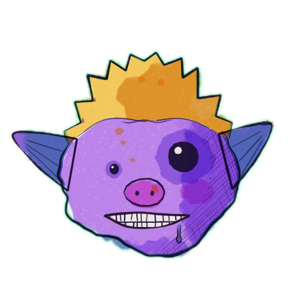
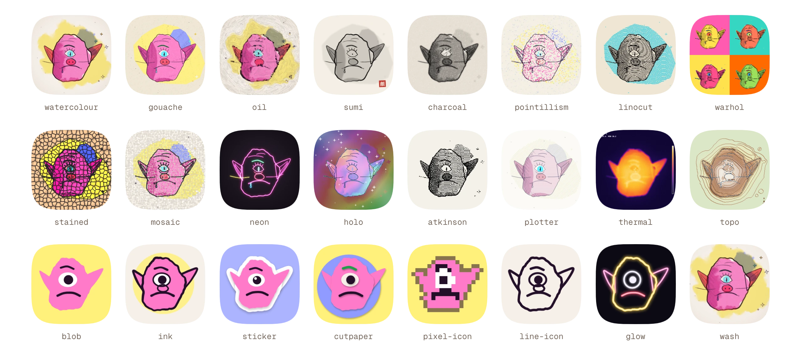
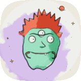
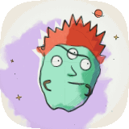
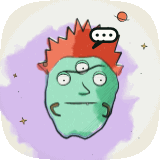
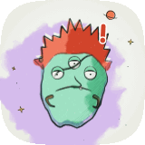
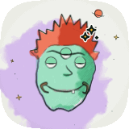

<p align="center">
  <a href="https://glorpies.vercel.app"></a>
</p>

<h1 align="center">glorpies</h1>

<p align="center"><b>Ugly little alien avatars from any string.</b></p>

<p align="center">
  
  
  <a href="https://github.com/sunrakerr/glorpies/blob/main/LICENSE"></a>
</p>

<p align="center">
  <a href="https://glorpies.vercel.app"><b>./site</b></a> &nbsp;·&nbsp;
  <a href="https://glorpies.vercel.app/gallery">./gallery</a> &nbsp;·&nbsp;
  <a href="https://glorpies.vercel.app/docs">./docs</a> &nbsp;·&nbsp;
  <a href="https://glorpies.vercel.app/how">./how</a> &nbsp;·&nbsp;
  <a href="https://github.com/sunrakerr/glorpies">./source</a>
</p>

Hand-painted in watercolour and dip pen. Antennae, extra eyes, horns, halos, too many teeth. And they're alive: they breathe, blink and glance at you.

**9,007,199,254,740,992** faces, over a million for every person on earth. A username, email or bot id always gets the same one, on every device and server. No API calls, no image downloads, nothing to store.

## Quick start

```bash
npm i glorpies
```

```tsx
import { Glorpie } from 'glorpies/react';

<Glorpie name="sunrakerrisfriednoodlz" size={48} />
```

By default, small avatars use the ink look; at 72px and above they use watercolour. To paint the Glorpie at the top of this page:

```tsx
<Glorpie name="sunrakerrisfriednoodlz" look="watercolour" size={192} background={false} />
```

## Anywhere: one tag

```html
<script type="module" src="https://unpkg.com/glorpies"></script>

<glorpie-face name="ada@lovelace.dev" size="48"></glorpie-face>
```

Works in plain HTML and in any framework (Vue, Svelte, Angular, Astro…). With a bundler, `import 'glorpies/element'` registers the tag.

## Photo fallbacks

A photo while it's available; a Glorpie while it loads, if it fails, or if there isn't one.

```tsx
import { Avatar, AvatarImage, AvatarFallback } from 'glorpies/react';

<Avatar size={40}>
  <AvatarImage src={user.photo} alt={user.name} />
  <AvatarFallback name={user.email} />
</Avatar>
```

The components render on the server as a soft placeholder in the face's own background colour, then paint on the client. React 18+ is supported; each framework integration uses your app's existing framework as an optional peer dependency.

## Vue, Svelte, Solid and Preact

The same `<Glorpie>`, with the same props, for each:

```vue
<script setup>
import { Glorpie } from 'glorpies/vue';
</script>

<template>
  <Glorpie :name="user.email" :size="40" state="thinking" />
</template>
```

```svelte
<script>
  import { Glorpie } from 'glorpies/svelte';
</script>

<Glorpie name={user.email} size={40} state="thinking" />
```

```tsx
import { Glorpie } from 'glorpies/solid'; // or 'glorpies/preact'

<Glorpie name={user.email} size={40} state="thinking" />
```

Each renders a placeholder on the server (Nuxt, SvelteKit, SolidStart) and paints in the browser. Svelte also gets a `use:glorpie` action for a canvas of your own. Angular, Astro and anything else that renders HTML use `<glorpie-face>`.

## Props and attributes

| prop | type | default | what it does |
| --- | --- | --- | --- |
| `name` | `string \| number` | required | Any string. The same name is always the same face. |
| `look` | look id \| `"auto"` | `"auto"` | `auto` paints watercolour, or the ink badge below 72px. |
| `size` | `number \| string` | `48` | Pixels, or any CSS length. |
| `shape` | `circle` `squircle` `rounded` `square` | `circle` | The crop. None without a background. |
| `background` | `boolean` | `true` | `false` keeps only the face: no backdrop, no pencil lines, no crop, transparent all around. |
| `state` | `idle` `thinking` `working` `waiting` `blocked` `done` | `idle` | What the face shows besides who it is. |
| `alive` | `boolean` | on, unless reduced motion | Breathing, blinking, glancing. On unless the reader prefers reduced motion. |
| `pokeable` | `boolean` | `false` | A tap makes the face wobble. |
| `label` | `string` | `"Avatar"` | Accessible name (`role="img"`). |
| `priority` | `number` | — | Higher values paint sooner when many faces are waiting. |

These are attributes on `<glorpie-face>` too: use `background="false"` or `alive="false"` to turn those options off. See [options and error handling](https://glorpies.vercel.app/docs/options) for framework-specific callbacks.

**Looks.** Paintings, for faces shown large: `watercolour`, `atkinson`, `bayer`, `plotter`, `cutout`, `neon`, `gouache`, `oil`, `sumi`, `charcoal`, `pointillism`, `linocut`, `warhol`, `stencil`, `stained`, `mosaic`, `felt`, `lowpoly`, `topo`, `thermal`, `holo`. Avatars, which still read at 16px: `blob`, `ink`, `sticker`, `cutpaper`, `pixel-icon`, `line-icon`, `glow`, `wash`.

**Without a background.** `background={false}` keeps the face, its crown and tentacles, and the sparkles of a celestial one, on nothing. Every look supports it; the crop is removed too.

<picture>
  <source media="(prefers-color-scheme: dark)" srcset="https://raw.githubusercontent.com/sunrakerr/glorpies/main/.github/assets/looks-dark.webp">
  
</picture>

**States.** Made for agents: a face you can tell apart in a crowded sidebar, and a status you read from the face itself. Each state changes the expression (mouth and brows, painted in the look's own hand), how the head moves, and adds a hand-drawn mark that still reads at 32px:

| state | mark | face |
| --- | --- | --- |
| `idle` | none | breathing, blinking and glancing |
| `thinking` | thought bubbles | eyes up and away, one brow raised, head tilted |
| `working` | typing bubble | eyes down reading, brows set, a steady nod |
| `waiting` | `?` | brows up, a hopeful smile, looking at you |
| `blocked` | red `!` | knitted brows, a frown, slumped, shaking now and then |
| `done` | sparkles | a big smile, a pleased squint, a little hop |

<p>     </p>

## Your own canvas

```ts
import { mount } from 'glorpies';

const face = mount(canvas, { name: 'agent-47', look: 'gouache', state: 'working' });
face.update({ state: 'done' });
face.destroy();
```

Faces paint once they come near the screen, at their displayed size × devicePixelRatio, and animate only while visible. Every face on a page shares one animation loop.

## Images, on a server

Faces as image files, from a route in your own app. Image rendering and the CLI need the optional `@napi-rs/canvas` peer dependency. Node deployments support Node 22 and newer:

```bash
npm i glorpies @napi-rs/canvas
```

```ts
// app/api/face/route.ts (Next.js)
import { faceRoute } from 'glorpies/server';
export const { GET } = faceRoute();
```

For a fetch-based server:

```ts
import { createFaceHandler } from 'glorpies/server';

Bun.serve({ fetch: createFaceHandler() });
```

For Express:

```ts
import express from 'express';
import { nodeFaceHandler } from 'glorpies/server';

const app = express();
app.get('/api/face', nodeFaceHandler());
app.listen(3000);
```

The fetch handler also fits SvelteKit, Nuxt, Astro, Hono and Deno; `nodeFaceHandler()` also fits `node:http`. [Setup for every framework](https://glorpies.vercel.app/docs/server).

```text
/api/face?name=agent-47&look=ink&size=128&shape=circle&format=png
/api/face?name=agent-47&state=thinking&format=gif
```

Query: `name` (required), `look`, `size` (16–1024; GIFs up to 320), `shape` (outside is transparent), `state`, `background` (`false` for only the face), `format` (`png`, `webp`, `jpeg`, `svg`, `gif`), and for GIFs `loop` (seconds) and `fps`. Responses are cached for a year: the same request always gives the same image.

GIFs loop seamlessly with a scripted pose, so the same name always loops the same way. Watercolour SVG is real vector paths; it's large, so prefer PNG or WebP at avatar sizes.

Or directly:

```ts
import { renderImage, faceGIF } from 'glorpies/server';
const { body, type } = await renderImage('agent-47', { look: 'sticker', size: 256, format: 'webp' });
const gif = await faceGIF('agent-47', { state: 'done', size: 128 });
```

## CLI

The CLI paints with `@napi-rs/canvas`, so ask npx for both:

```bash
npx -p glorpies -p @napi-rs/canvas glorpies agent-47 --look ink --size 128 --shape circle -o agent.png
npx -p glorpies -p @napi-rs/canvas glorpies agent-47 --state thinking -f gif
```

Installed in a project (`npm i glorpies @napi-rs/canvas`), it's just `npx glorpies agent-47`.

## API

| | |
| --- | --- |
| `mount(canvas, options)` | brings a face to life on your canvas; returns `update`, `poke`, `destroy` |
| `faceCanvas(name, options)` | one finished picture, in any look, state and shape |
| `faceSVG(name, options)` | SVG markup |
| `faceColors(name)` | the palette a face is painted in, to theme what sits around it |
| `seedOf(name)` | the number behind a name, below `FACES` (2^53: there are 9,007,199,254,740,992 faces) |
| `randomName()` | a made-up name for a face nobody has named yet, like `soggy-glorp` |
| `LOOKS`, `STATES`, `SHAPES` | everything there is to choose from |
| `setCanvasFactory(f)` | draw on canvases from anywhere (the server entry does this for you) |

The full guide, with every framework, is at [glorpies.vercel.app/docs](https://glorpies.vercel.app/docs).

## Licence

Made by [sunrakerr](https://github.com/sunrakerr).

[MIT](LICENSE). Bundled third-party licences are in [THIRD-PARTY-NOTICES.md](THIRD-PARTY-NOTICES.md).
